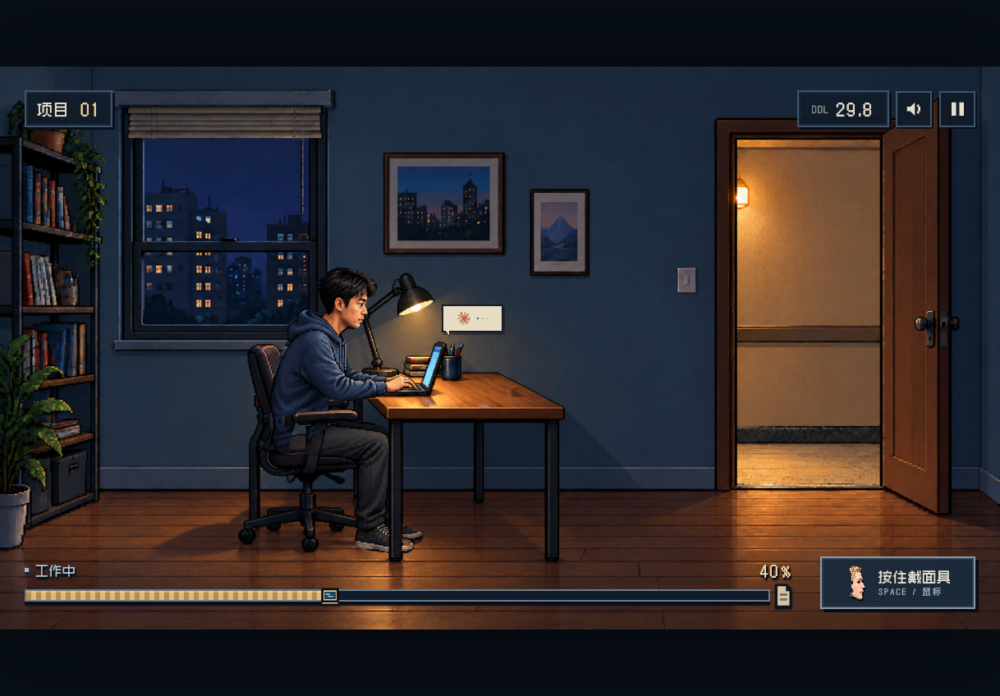

# 下一个项目

一个像素风潜行工作小游戏。在工作、伪装和截止日期之间周旋，完成项目，然后接下一个。

本作为虚构讽刺游戏。

## 开始游玩

下载 `index.html`，用浏览器直接打开即可。游戏资源均已内嵌，无需安装依赖或启动服务。建议横屏游玩。

| 操作 | 效果 |
| --- | --- |
| 按住空格或画面右下角按钮 | 戴上面具，暂停工作 |
| 松开 | 摘下面具，继续工作 |
| Esc 或右上角暂停按钮 | 暂停、继续 |
| 右上角声音按钮 | 切换声音 |

留意门口的动静，在截止日期前完成进度。交付后会自动进入下一个项目。

## 文件

- `index.html`：可直接运行的完整游戏。
- `docs/preview.png`：游戏画面。
- `THIRD_PARTY_NOTICES.md`：第三方字体信息。
